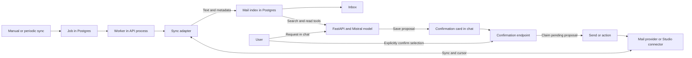

# Architecture

## Runtime and interfaces

- **Web.** TanStack Start, Router and Query power the UI in German and English ([catalogues](../apps/web/src/i18n/)). The generated API client uses the same origin as the page. Under `vite dev`, the dev server proxies `/api` to the API on `http://127.0.0.1:3000`, so local starts keep that origin too. [Web routes](../apps/web/src/routes/_app/) · [Client configuration](../apps/web/src/api/client-config.ts) · [Dev proxy](../apps/web/vite-plugins/fastapi-tanstack-start.ts) · [Local development](local-development.md)
- **API.** FastAPI wires in the router tree and the startup and shutdown hooks. The OpenAPI contract contains paths, methods, `operationId`s and data schemas. Client generation checks it against the routes and the web client. [FastAPI entry point](../apps/api/src/api/main.py) · [Router tree](../apps/api/src/api/routers/) · [OpenAPI contract](../apps/api/openapi.json) · [Client generation](../tools/gen-types.sh)
- **Database and worker.** Postgres stores the mail index, chat history and other domain data. SQLModel models define tables, accessors encapsulate queries and changes, and Alembic versions the schema. The startup hook starts the worker in the API process if enabled. Jobs remain stored in Postgres. [Models](../packages/py/db/src/db/models/) · [Accessors](../packages/py/db/src/db/accessors/) · [Migrations](../packages/py/db/src/db/migrations/) · [Startup hook](../apps/api/src/api/lifespan/startup/mail_worker.py)
- **Studio.** The manifest describes web under `/`, API under `/api` and a managed Postgres service. The deployment restricts access to the single-user app. The versioned API has no user management of its own. [Manifest](../mistral.json) · [API access rule](../apps/api/src/api/routers/api/v1/__init__.py) · [Providers and operations](providers-and-operations.md)

The minimal chat app has its own Node server and demonstrates a direct call to the Mistral API. The Studio manifest contains the main application from `apps/web` and `apps/api`. [Minimal chat app README](../apps/chat-app/README.md)

## From mail sync to confirmation

1. **Sync.** A manual sync or periodic check queues deduplicated jobs per account. The worker chooses the adapter according to the account connection. The sync service updates indexed mails and stores the cursor per account. For new mail, the worker queues a job for missing summaries. The full-text index covers subject, sender and processed mail text. [Worker](../apps/api/src/api/mail/jobs.py) · [Sync service](../apps/api/src/api/mail/sync.py) · [Text processing](../apps/api/src/api/mail/sync_types.py) · [Full-text index](../packages/py/db/src/db/models/mail_message.py)
2. **Read and propose.** The chat stream delivers typed Server-Sent Events. The agent stores the history and works with an account scope recorded per turn. Its tools search the inbox, read mail, retrieve summaries and create proposals for sending, archive, trash, marking read or newsletter unsubscription. For sending, drafts also include replies, reply-all and forwards. [Chat stream](../apps/api/src/api/routers/api/v1/chat/stream.py) · [Agent](../apps/api/src/api/mail/agent.py) · [Tools](../apps/api/src/api/mail/agent_tools.py)
3. **Execute.** The proposal card sends the explicit selection to the confirmation route. A conditional database update sets the pending proposal to `running` if its turn context, if any, is still valid. Only then does the proposal service send or perform the action and save the result per entry. Cancel discards a pending proposal. Individual actions initiated directly by the user in the inbox go through the mail action route and offer “Rückgängig” (UI text) for supported actions. [Proposal card](../apps/web/src/chat/ProposalCard.tsx) · [Confirmation route](../apps/api/src/api/routers/api/v1/chat/proposals.py) · [State transition](../packages/py/db/src/db/accessors/chat_message.py) · [Proposal service](../apps/api/src/api/mail/proposals.py) · [Mail action route](../apps/api/src/api/routers/api/v1/mail/messages.py) · [Undo](../apps/api/src/api/mail/actions.py)

## Data and feature boundaries

| Area | Persistence and current UI |
| --- | --- |
| **Mail** | `mail_account`, `mail_credential`, `mail_sync_state` and `mail_job` hold connection and sync state. `mail_message`, `mail_insight` and `mail_action` store the index, summaries and action history for “Rückgängig” (UI text). The mail view shows text and attachment metadata. Attachment downloads remain outstanding. Original and headers are retrieved from the provider for supported accounts and remain outside the index. The web list shows the inbox. The API also permits queries of locally indexed archive and trash rows. [Mail view](../apps/web/src/mail/MailView.tsx) · [Original retrieval](../apps/api/src/api/mail/original.py) · [Mail API](../apps/api/src/api/routers/api/v1/mail/messages.py) |
| **Chat and templates** | `chat_conversation`, `chat_message` and `chat_context` store history, proposals and the resolved context of a turn. The template library supports creation, editing and deletion. `prompt_template` points to the current `prompt_revision`, while the selection in chat is pinned to a specific revision. The agent passes the template as user content. Deletion removes template content, resets affected selections and revokes the associated turn contexts. [Template library](../apps/web/src/prompts/Library.tsx) · [Template selection](../apps/web/src/prompts/TemplateMenu.tsx) · [Version management](../packages/py/db/src/db/accessors/prompt_template.py) |
| **Calendar** | `calendar_source`, `calendar_event`, `calendar_occurrence` and `calendar_sync_state` store sources, events, occurrences and coverage. `calendar_feed_config` holds encrypted ICS subscriptions, and `calendar_write` records every write to Google. Sources are Google calendars through the Studio connector and ICS subscriptions; the shared worker syncs complete snapshots periodically and on request. The calendar view shows month, week, day and list. Single events in writable Google calendars can be created, changed and deleted. In chat the agent reads the index through `search_calendar` and `get_calendar_occurrence` and proposes changes as confirmation cards. [Calendar routes](../apps/api/src/api/routers/api/v1/calendar/) · [Snapshot sync](../apps/api/src/api/calendar/sync.py) · [ICS adapter](../apps/api/src/api/calendar/ics.py) · [ICS tests](../apps/api/tests/test_calendar_ics_parse.py) · [Calendar UI](../apps/web/src/calendar/) · [ICS subscriptions](../apps/api/src/api/calendar/feeds.py) · [Google read](../apps/api/src/api/calendar/google.py) · [Google write](../apps/api/src/api/calendar/writes.py) · [Chat tools](../apps/api/src/api/mail/calendar_tools.py) |
| **Tasks** | `task_series`, `task_schedule_revision` and `task_occurrence` separate series, schedule and specific due date. The API offers creation, preview, reading, rescheduling, archiving and deletion, as well as completing, skipping and reopening occurrences. Reconcile materializes due dates page by page. Read calls operate on stored data. The task view lists, creates and reschedules tasks. In chat the agent reads tasks within a visible task scope and proposes changes as confirmation cards, never a permanent deletion. [Tasks API](../apps/api/src/api/routers/api/v1/tasks/) · [Reconcile](../apps/api/src/api/tasks/reconcile.py) · [Task UI](../apps/web/src/tasks/) · [Chat tools](../apps/api/src/api/tasks/chat.py) |

Settings cover the template library, mail accounts allowed in chat, mail accounts granted to MCP, the default calendar, swipe actions, preferences, the app language and outside agent access. Swipe actions and the language are stored on the server and apply on every device; the appearance is saved as a browser preference. [Settings](../apps/web/src/prompts/Settings.tsx) · [Appearance](../apps/web/src/shell/theme.ts)

## Agents and Studio

The internal mail assistant's tools are defined in `agent_tools.py`. A Studio HTTP connector is a separate integration path. Upon import, every operation in the imported OpenAPI contract can appear as an MCP tool. The read permission in `AGENTS.md` applies to this path. The inventory test compares the allowlist with the API operations. A read-only agent facade under `/api/agent-read/v1` and a stateless Streamable HTTP MCP transport at `/api/mcp` (`mistral.json` flagged `"mcp": true`) serve only the four approved mail reads from `api/mcp/registry.py`, with account scope managed in `mcp_settings` (`/settings/mcp`). Both remain fail-closed (`DenyReadAccess`) unless `MCP_STUDIO_OWNER` is configured. Before any verifier runs, every agent path checks the owner's switch "Zugriff von außen" (`agent_access`), which is off by default and refuses agent requests inside the app without revoking tokens at the gateway. [Internal tools](../apps/api/src/api/mail/agent_tools.py) · [Read permission](../AGENTS.md#security) · [Inventory test](../apps/api/tests/test_mcp_exposure.py) · [Agent read facade](../apps/api/src/api/mcp/) · [MCP setup](mcp.md)

The UI specification of 13 November 2026 documents the design at that time. The Studio probes from the same day record gateway and connector behavior at the time of measurement. [UI rules](../DESIGN.md) · [Historical UI specification](superpowers/specs/2026-11-13-oberflaeche-und-mail-aktionen-design.md) · [Studio probes](superpowers/probes/2026-11-13-studio-proben.md) · [Local development](local-development.md)
